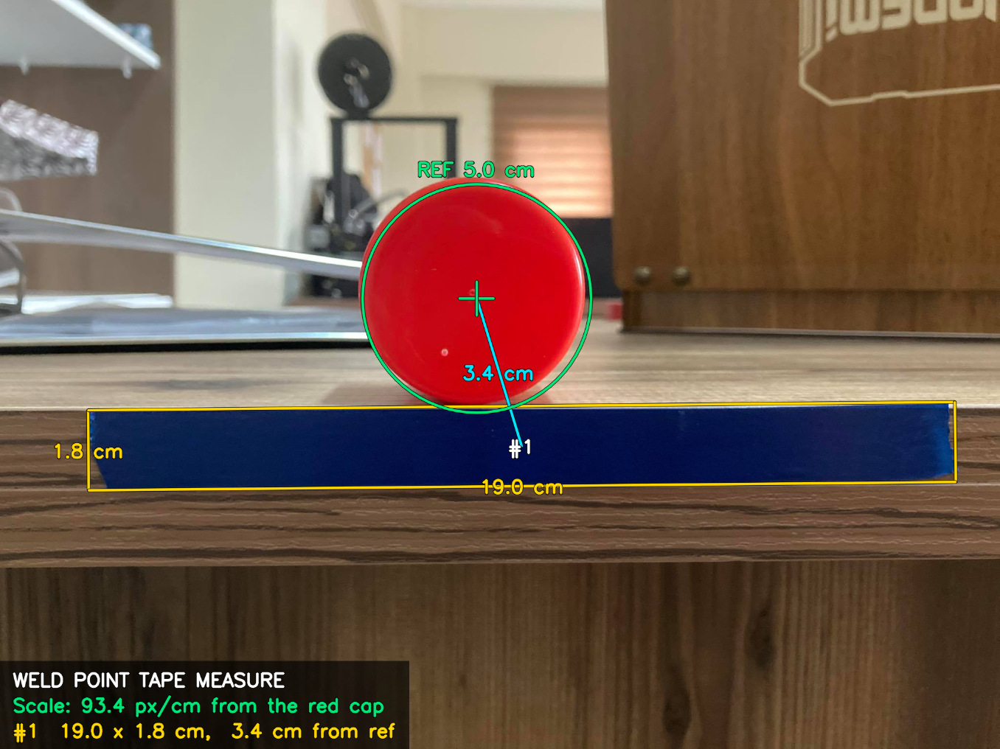
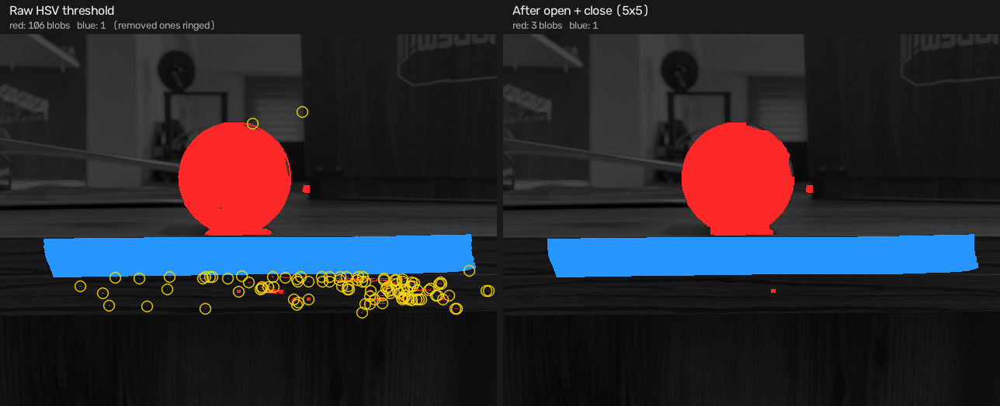

# Opencv Image Processing: weld point tape measure

A prototype for a robotic welder that was made in 2020. In the workshop, weld points are marked with strips of
blue tape, and a red round cap exactly 5 cm across sits next to them. The app watches through the phone camera and uses the red cap as its
ruler. On every frame it shows each strip's length, width and distance from the cap, drawn
straight onto the frame with OpenCV.

In the photo the tape comes out at 19.0 × 1.8 cm. The 1.8 cm matches the 18 mm desk board edge
it covers. The panel at the bottom-left shows the scale taken from the red cap (px/cm), one
line per tape strip, and the frame rate on the live camera. The button switches between the
live camera and this sample photo. A phone with no back camera gets the photo only.

## How it measures

1. **Prepare.** Downscale the frame to 640 px wide and convert it to HSV (`measure/HsvFrame`).
2. **Clean up the colour masks.** All of this is done with OpenCV 3.4.1. Each colour is picked
   out with an HSV threshold (`Core.inRange`), which also catches stray pixels elsewhere in the
   frame and leaves small holes in the real objects (highlights on the cap, creases in the
   tape). OpenCV's morphology operations then tidy the mask. An opening (`Imgproc.erode`, then
   `Imgproc.dilate`) with a 5×5 square removes specks smaller than about 5 px of the working
   image. A closing (`Imgproc.dilate`, then `Imgproc.erode`) fills holes and gaps of that size,
   so the outlines follow the actual cap and tape. In the sample photo, about a hundred red
   specks come down to three blobs (`measure/ColorMask`). The size and shape checks in the next
   two steps drop what is left.
3. **Find the reference.** It is the largest red blob that is close to a circle (red wraps
   around the hue circle, so two hue ranges are combined). The diameter used is that of a
   circle with the blob's area, so a stray red pixel at the edge barely moves it.
   Scale = diameter_px / 5 cm (`measure/ReferenceDetector`).
4. **Find the tape.** Strips are long, solid blue blobs fitted with a rotated rectangle
   (`minAreaRect`). It keeps up to five, numbered left to right so the numbers don't jump
   between frames. A strip running off the frame edge is flagged, and its length is shown as
   a minimum (`>12.3 cm`) (`measure/TapeDetector`).
5. **Convert to centimetres.** Length and width, plus the centre-to-centre distance from the
   cap (`measure/TapeReading`). On the live camera the scale is smoothed between frames. A jump
   is accepted only once it holds for 3 frames, and the last scale is kept briefly if the cap
   drops out (`measure/ScaleFilter`).
6. **Draw.** Outlines and labels go on the frame, the summary in a shaded panel (`overlay/`).

Step 2 on the sample photo, at the 640 px working size. On the left are the raw masks, with
each speck that the cleanup removes ringed in yellow; most sit in the wood grain under the
tape. On the right are the masks that steps 3 and 4 work with.

## Architecture (MVC)

| Layer | Package | Role |
|---|---|---|
| Model | `measure/` | Detection and measurement. Plain OpenCV, no Android UI. |
| View | `overlay/`, `res/layout` | Draws a measurement onto a frame; the screen layout. |
| Controller | `MainActivity` | Camera check and permission, camera/photo mode, frames in and out. |
| Glue | `pipeline/` | `FrameProcessor` (what the controller depends on) and `MeasurementPipeline` (measure → centimetres → draw). |
